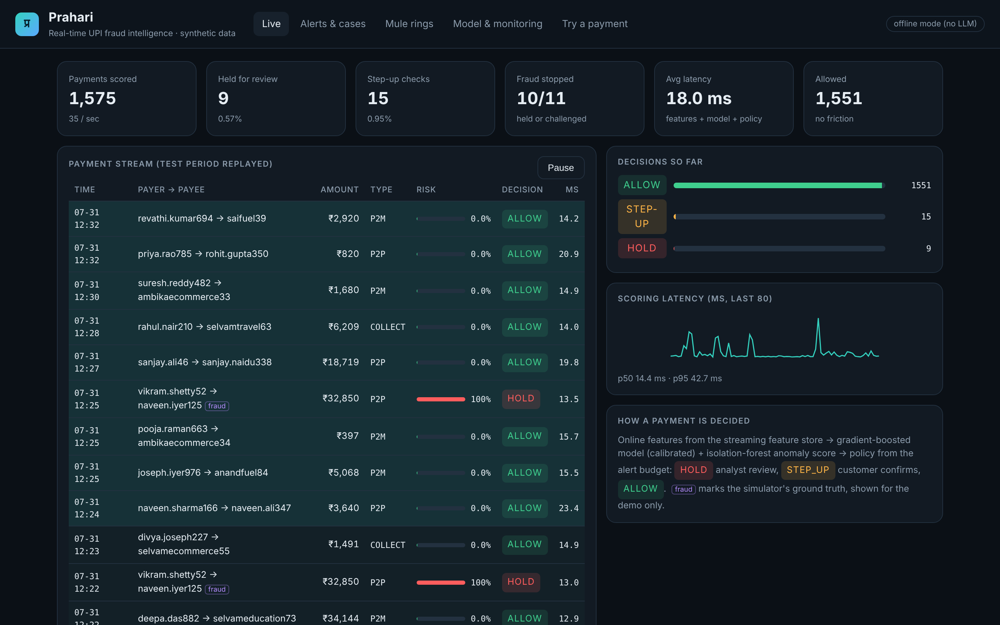
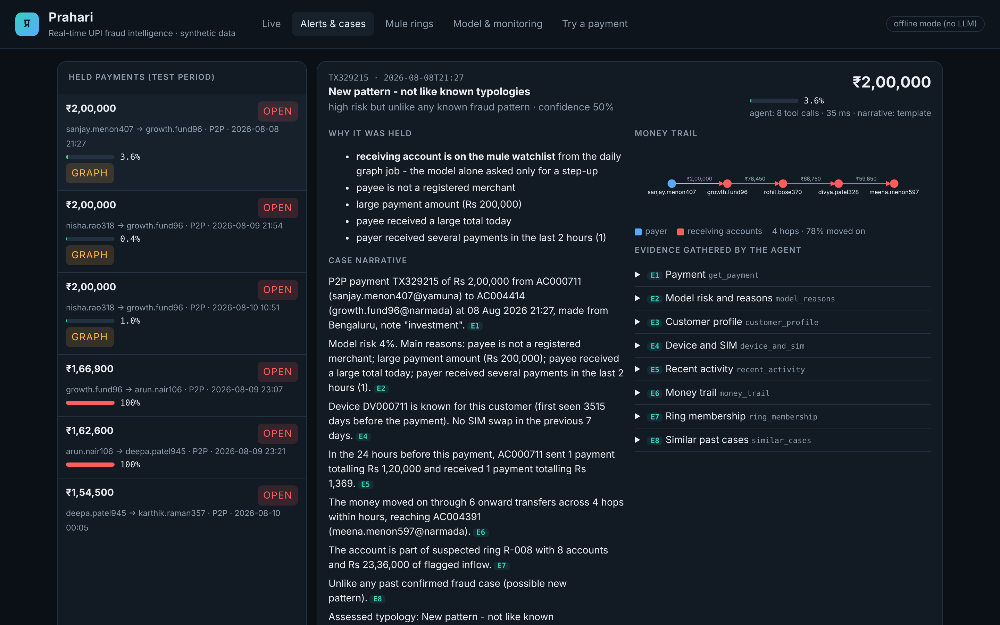
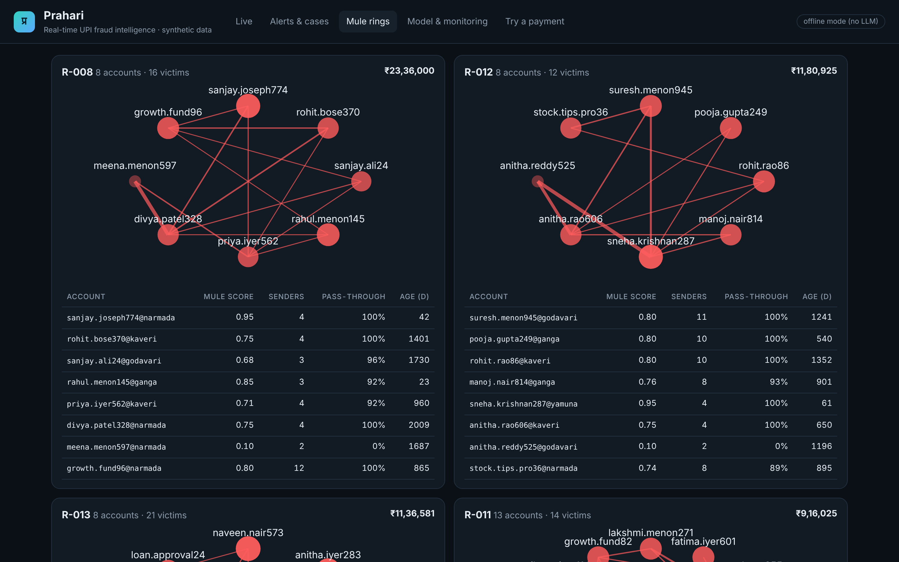
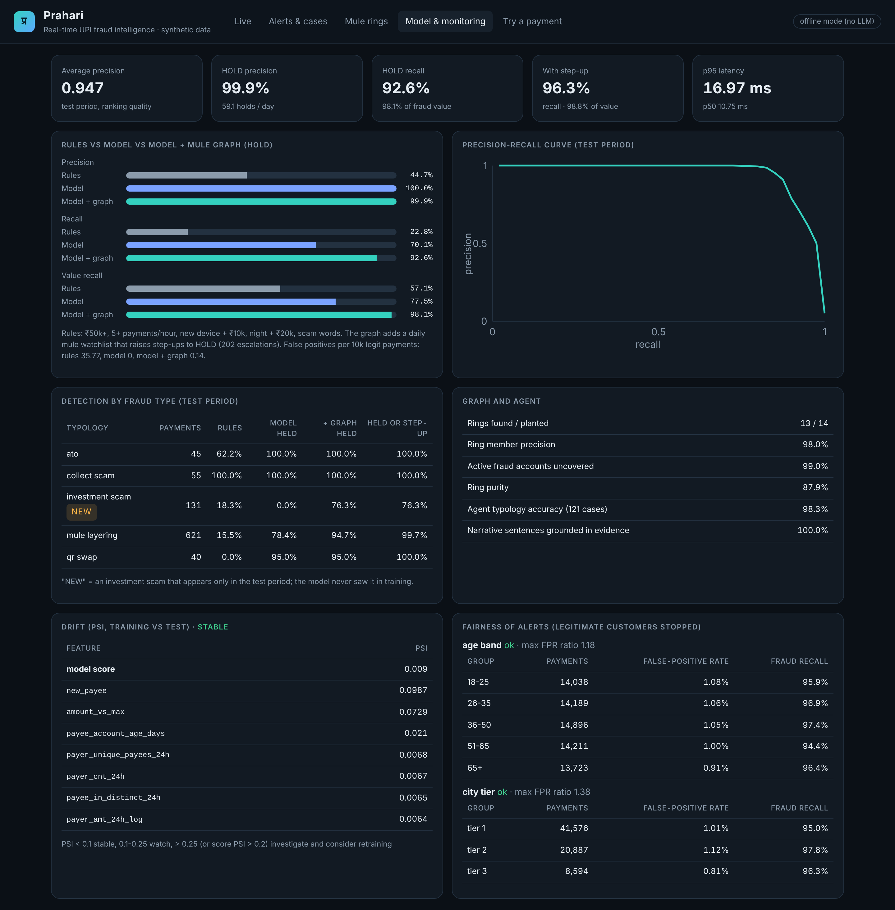
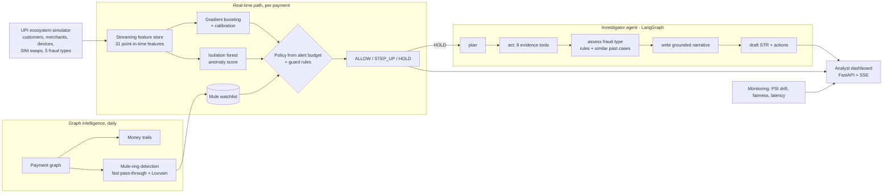

# Prahari: Real-time UPI Fraud Intelligence Platform

[](https://github.com/vigneshwarbhuvi2911-ctrl/prahari/actions/workflows/ci.yml)

*Prahari* (प्रहरी) means "guard" or "sentry" in Hindi.

Prahari is a working fraud-detection system for UPI payments. It covers the whole chain, from scoring each payment to an investigator's case file:

1. **Score every payment in real time** (about 11 ms each). A streaming feature store feeds a calibrated gradient-boosted model and an anomaly model. The result is one of three decisions: **ALLOW**, **STEP_UP** (ask the customer to confirm) or **HOLD** (stop it for review).
2. **Follow the money through the payment graph.** Prahari traces where stolen money goes next and finds the **mule rings** that launder it. A daily graph job adds ring accounts to a watchlist, so later payments to them are held. This is how it catches a scam type the model **never saw in training**.
3. **Investigate every held payment with an AI agent** (LangGraph). The agent calls 8 evidence tools, classifies the fraud type and writes a case narrative in which every sentence cites its evidence. It then drafts a Suspicious Transaction Report for the analyst to approve.
4. **Prove it with measurements.** Prahari compares itself with a hand-written rules baseline and reports by-fraud-type results, drift (PSI), fairness by age band and city tier, and latency. **CI blocks any change that fails the quality gates.**

> **Personal project on synthetic data.** Prahari includes its own simulator of a UPI ecosystem, with customers, merchants, devices, SIM swaps, mule rings and five fraud types. No real customer or bank data is used. Metrics on simulated data are optimistic and show that the system works end to end; they are not a claim about real-world fraud rates.



## Results

All results below come from the held-out test period (the last 15 days, 71,057 payments, 892 fraudulent). The model never sees this period during training. The full report is generated by `python -m eval.run` (see [eval/REPORT.md](eval/REPORT.md)).

| Approach (HOLD decision) | Precision | Recall | Share of fraud value stopped | False positives per 10k legit |
|---|---|---|---|---|
| Hand-written rules baseline | 44.7% | 22.8% | 57.1% | 35.8 |
| Model only | 100.0% | 70.1% | 77.5% | 0.0 |
| **Model + mule graph** | **99.9%** | **92.6%** | **98.1%** | **0.14** |
| Model + graph, HOLD or STEP_UP | 54.5% | 96.3% | 98.8% | 102 |

| Fraud type | Rules | Model only | Model + graph |
|---|---|---|---|
| Account takeover (SIM swap + new device) | 62% | 100% | 100% |
| Collect-request scam | 100% | 100% | 100% |
| QR code swap at merchants | 0% | 95% | 95% |
| Mule layering | 16% | 78% | 95% |
| **Investment scam (new: only in the test period)** | 18% | **0%** | **76%** |

The last row matters most. The model scored the new scam as low risk because it had never seen it. The graph still caught most of it, because the scam money flowed into accounts that were already behaving like mules. The agent then labelled those cases **"new pattern"** for the fraud-strategy team rather than forcing them into a known type.

| Other measures | |
|---|---|
| Average precision | 0.947 |
| Mule rings found | 13 of 14 planted. Account precision 98%, recall 99% |
| Agent fraud-type accuracy | 98.3% on 121 cases. 100% of narrative sentences grounded in cited evidence |
| Latency, live path (features + model + policy) | p50 11 ms, p95 18 ms |
| Drift (PSI, train vs test) | stable |
| Fairness (false-positive rate ratio across groups) | age band 1.18, city tier 1.38: ok |

## What it looks like

| Investigation case file | Mule rings |
|---|---|
|  |  |



## Architecture



**Payment flow.** A payment arrives and the streaming feature store computes 31 features using only what was known *before* that payment. These include velocity, new payee, device age, hours since a SIM swap, how much of a recent credit the payer is passing on, how many people are paying the payee, scam words in the note, and others. The model and the anomaly detector score the payment. The policy then turns the score into a decision using thresholds set from an **alert budget**: at most about 0.5% of payments held and 1.2% stepped up. Two more checks apply. A guard rule always holds a payment of Rs 10,000 or more made from a new device within 24 hours of a SIM swap. A payment to an account on the mule watchlist is raised from STEP_UP to HOLD.

**Design choices worth noting**

- **No training/serving skew.** Training features and live features come from the same `FeatureStore` code. A test replays the live stream and checks that it produces exactly the training matrix.
- **Time-based evaluation.** The data is split into a 14-day warm-up, then training, validation (used for thresholds and calibration) and test, in that order. There is no random split, so no information from the future leaks into training.
- **No look-ahead in the graph job.** The watchlist is rebuilt once per day from holds up to the previous day, and a payment is escalated only if its payee was already listed.
- **Hard negatives.** The simulator includes legitimate behaviour that looks like fraud: phone upgrades, real SIM replacements, travel, night owls, large one-off transfers, new accounts and shops. It also includes "aged" mule accounts with normal-looking history, so the model cannot rely on easy signals.
- **Explanations.** Each decision lists the features that pushed its risk up, found by perturbation. Reasons that would read as nonsense are filtered out.
- **The agent cannot make things up.** Planning is limited to an allow-list of tools. In the narrative, every amount, account id and time must appear in the evidence that the sentence cites, or the sentence is removed. If none survive, a template narrative is used. The agent only drafts; the analyst decides.

More detail: [docs/DESIGN.md](docs/DESIGN.md).

## Run it

**Docker (one command):**

```bash
docker compose up --build        # builds data + models into the image (about 2 minutes), then serves
# open http://localhost:8000
```

**Local:**

```bash
pip install -r requirements-dev.txt
python -m prahari build          # simulate about 330k payments, train, build the graph, evaluate (about 2 minutes)
uvicorn prahari.api:get_app --factory --port 8000
python -m pytest                 # 25 tests on a small simulated world (about 1 minute)
python -m eval.run               # quality gates + eval/REPORT.md
```

Use `PRAHARI_SCALE=small` for a quick build.

**LLM (optional).** Everything works offline: the agent uses its investigation playbook and template narratives. To let an LLM plan the investigation and write the narrative, set `LLM_PROVIDER` to `openai`, `azure` or `bedrock` (see `.env.example`). The verification step still checks every sentence the LLM writes.

## API

| Method | Path | Purpose |
|---|---|---|
| GET | `/api/stream?rate=40` | Server-sent events: the test period replayed as a live stream of scored payments |
| POST | `/api/score` | Score a payment: decision, calibrated risk, anomaly score, reasons, latency |
| GET | `/api/alerts` | Analyst queue of held payments, ordered by money at risk |
| GET | `/api/cases/{txn_id}` | Run (or fetch) the agent's investigation: evidence, fraud type, narrative, STR draft |
| POST | `/api/cases/{txn_id}/decision` | Analyst outcome: `confirmed_fraud`, `false_positive` or `escalated` |
| GET | `/api/rings` | Detected mule rings with members, mule scores and edges |
| GET | `/api/trail/{txn_id}` | Money trail of a payment, hop by hop |
| GET | `/api/metrics` | Full evaluation: model vs rules, by fraud type, graph, agent, drift, fairness, latency |

Example:

```bash
curl -s localhost:8000/api/score -H 'Content-Type: application/json' \
  -d '{"payer":"AC000301","payee":"AC004301","amount":95000,"type":"P2P","device":"DV-NEW-99"}'
# AC004301 is a mule account on the graph watchlist in the default simulated world (GET /api/accounts/examples)
# -> HOLD, with the reasons: on the mule watchlist, not a merchant, large amount, brand-new device
```

## Project layout

```
prahari/
  sim.py        UPI ecosystem simulator (customers, merchants, devices, SIM swaps, fraud typologies, mule rings)
  features.py   streaming point-in-time feature store (same code for training and serving)
  model.py      gradient boosting + calibration + isolation forest, alert-budget policy, explanations, rules baseline
  graph.py      payment graph: money trails, mule scores, ring detection
  agent.py      LangGraph investigator: plan -> act -> assess -> write -> report, grounded-narrative check
  monitor.py    PSI drift and fairness reports
  pipeline.py   end-to-end build, daily graph job, live replay, evaluation, investigation tools
  api.py        FastAPI service + server-sent events;  static/index.html  analyst dashboard
eval/run.py     quality gates and report;  tests/  25 tests
```

## Tech stack

Python, scikit-learn (HistGradientBoosting, logistic (Platt) calibration, IsolationForest, nearest neighbours), NetworkX (graph analysis, Louvain communities), LangGraph, FastAPI with server-sent events, OpenAI / Azure OpenAI / Amazon Bedrock (optional), Docker, GitHub Actions.

## Limits and next steps

- Synthetic data: real fraud is messier, labels arrive late and are incomplete, and the fraud mix shifts. Next steps would be delayed-label training, analyst feedback as labels, and champion/challenger deployment.
- The graph job runs daily. A production version would update ring scores continuously in a graph database or stream processor.
- State is in memory for the demo. A production system would use an online feature store (for example Redis), a message bus, and a case-management database.

---
Built by K S Vigneshwar.
